# EmployeeHub — Full-Stack Employee Management System

EmployeeHub is a full-stack employee management application built to demonstrate modern software engineering practices using .NET 10, Clean Architecture, SQL Server, Angular, and Blazor.

The project includes a secured REST API, two frontend implementations, automated testing, distributed caching, structured logging, and workflow automation.

## Technologies

- **Backend:** .NET 10, ASP.NET Core Web API, C#
- **Architecture:** Clean Architecture, Repository Pattern, Service Layer, Dependency Injection
- **Database:** SQL Server, Entity Framework Core
- **Caching:** Redis
- **Authentication and Authorization:** JWT, role-based authorization, policy-based authorization
- **Frontends:** Angular, TypeScript, Bootstrap, Blazor
- **API Documentation:** OpenAPI, Scalar, URL-based API versioning
- **Logging:** Serilog, structured logging, daily log files
- **Testing:** xUnit, Moq, automated unit and integration tests
- **Automation:** n8n


## Key Features

- Employee CRUD operations
- User authentication and role-based access control
- Admin-only restrictions for employee creation, updates, and deletion
- Server-side validation and client-side form validation
- Redis distributed caching
- Idempotent employee creation using idempotency keys
- Optimistic concurrency control using SQL Server row versions
- Consistent API versioning
- Structured application logging
- Automated unit and integration tests
- Angular and Blazor user interfaces
- Workflow automation using n8n

## Architecture

EmployeeHub separates business logic, application services, and infrastructure concerns into distinct projects.

- **EmployeeHub.Domain:** Core domain entities
- **EmployeeHub.Application:** DTOs, interfaces, and application services
- **EmployeeHub.Infrastructure:** Database context and data access implementations
- **EmployeeHub.Api:** REST API, controllers, authentication, and API configuration
- **EmployeeHub.Api.Tests:** Automated tests
- **EmployeeHub.Angular:** Angular frontend
- **EmployeeHub.Blazor:** Blazor frontend

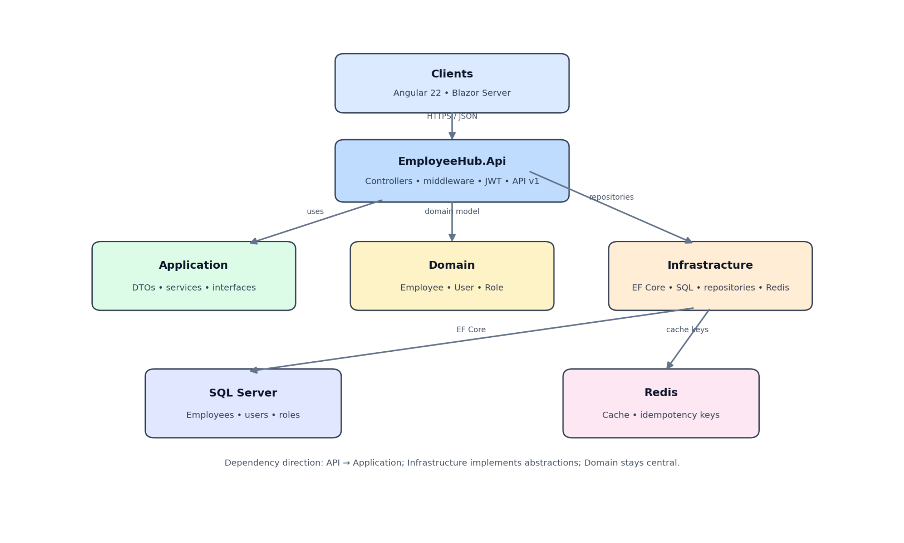

## Security

The application uses JWT authentication and authorization policies to protect API endpoints. Passwords are handled using password hashing, and administrative operations require appropriate authorization.

Sensitive configuration values must be supplied through local configuration or environment variables rather than committed to source control.

## Testing

EmployeeHub includes automated unit and integration tests using **xUnit** and **Moq**.

The solution was tested successfully using `dotnet test`.

**Verified test results:**
- **Total tests:** 13
- **Passed:** 13
- **Failed:** 0
- **Skipped:** 0

The tests cover important application and API behavior, including employee operations, authentication, authorization, and HTTP responses.

To run the tests locally, open a terminal in the solution directory and execute:

```powershell
dotnet test
```

## Running the Project

### Prerequisites

Install the following tools:

- **.NET 10 SDK**
- **SQL Server**
- **Redis**
- **Node.js and npm** for the Angular frontend
- **Visual Studio** or another compatible .NET development environment

### Configuration

Before starting the application, configure the required settings:

- **SQL Server:** Store the database connection string in ASP.NET Core User Secrets.
- **Redis:** Configure the `Redis:ConnectionString` setting.
- **JWT authentication:** Store the JWT signing key and related settings in User Secrets for local development.
- **n8n integration:** Configure the required webhook URL and authentication header settings if running the department report workflow.

Do not commit real credentials, signing keys, or other sensitive configuration values to source control.

### Start Redis

EmployeeHub uses Redis for distributed caching and idempotent employee creation. Ensure Docker Desktop is running, then start the Redis container:

```powershell
docker start employeehub-redis
```

If the `employeehub-redis` container has already been created, this command starts it. Verify that the container is running:

```powershell
docker ps
```

If the container does not exist yet, create it using the Redis configuration established for your local environment before proceeding.

### Start the API

From the solution directory, run:

```powershell
dotnet run --project EmployeeHub.Api
```

The API launch profile is configured to use:

`http://localhost:5239`

Ensure that SQL Server and Redis are available and that the required configuration has been set before starting the API.

### Run the Automated Tests

From the solution directory, execute:

```powershell
dotnet test
```

The solution's verified test results are documented in the Testing section above.

### Frontend Applications

The repository includes two frontend implementations:

- **Angular:** Requires Node.js and npm. Use the Angular project's package scripts to install dependencies and start the development server. 
- **Blazor:** Run the `EmployeeHub.Blazor` project using Visual Studio or the .NET CLI.

Consult each project's configuration for its specific startup settings.


### Run the Angular Frontend

The Angular frontend uses Angular 22, TypeScript, and Bootstrap.

Open a terminal in the `EmployeeHub.Angular` directory:

```powershell
cd EmployeeHub.Angular
```

Install the dependencies:

```powershell
npm install
```

Start the development server:

```powershell
npm start
```

The Angular development server will display its local URL in the terminal, typically `http://localhost:4200`.

To create a production build, run:

```powershell
npm run build
```

Ensure the EmployeeHub API is running and that the frontend's API configuration points to the correct API URL.

### Run the Blazor Frontend

EmployeeHub includes a Blazor frontend that uses the same backend API as the Angular application.

From the solution directory, run:

```powershell
dotnet run --project EmployeeHub.Blazor
```

The Blazor development server is configured to use:

`http://localhost:5193`

Ensure the EmployeeHub API is running and that the Blazor application's API configuration points to the correct API URL.

The Angular and Blazor frontends provide alternative user interfaces for managing employees through the EmployeeHub API.


## Project Purpose

EmployeeHub is a portfolio project demonstrating full-stack development, backend architecture, database integration, API security, frontend development, automated testing, and workflow automation.

## AI-Powered Department Report

EmployeeHub integrates with an n8n workflow to generate an employee department report using data from the EmployeeHub API.

The workflow demonstrates how application data can be retrieved through an API, processed by an automation workflow, and presented in a readable report with AI assistance.

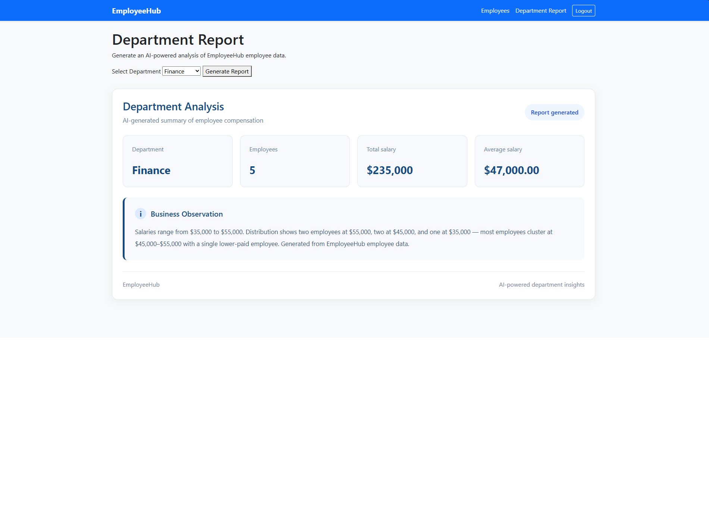

**What this demonstrates:**
- Integration between the EmployeeHub API and n8n.
- Workflow automation for retrieving and processing employee data.
- AI-assisted report generation and presentation.
- Combining .NET application development with AI automation.


## Application Screenshots

EmployeeHub includes two frontend implementations built on the same backend API: Angular and Blazor.

### Angular Frontend

**Employee Management**

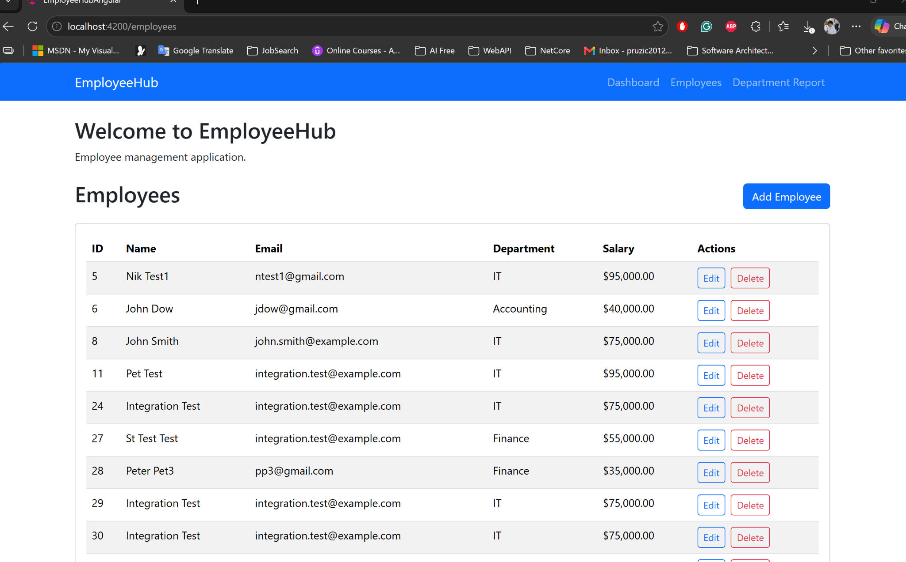

**Login**

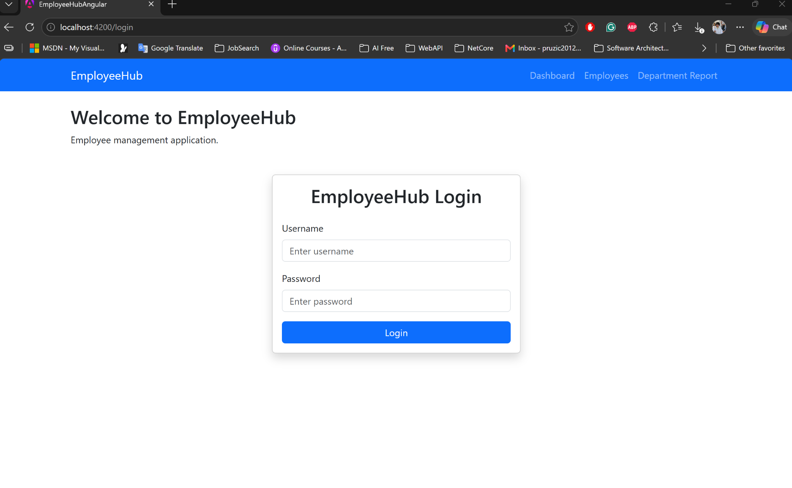

**Add Employee**

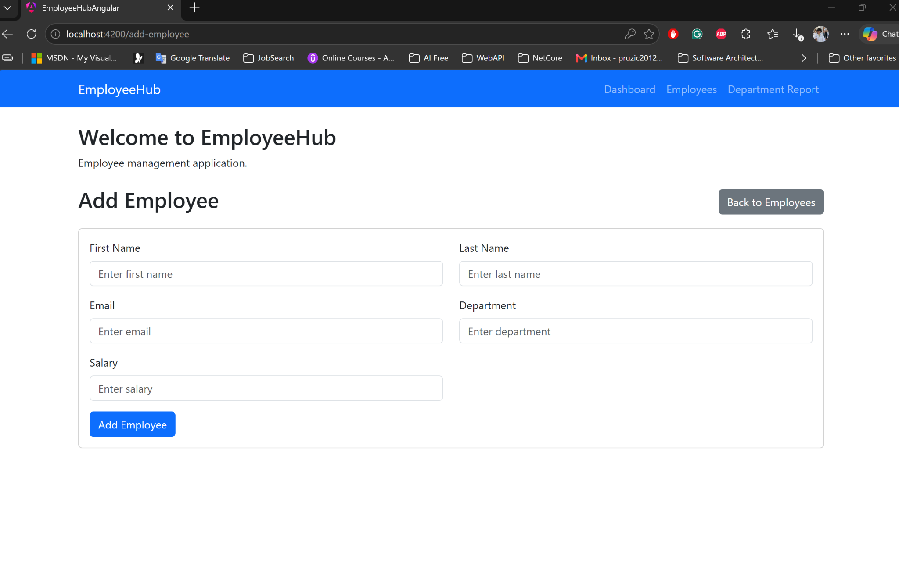

**Edit Employee**

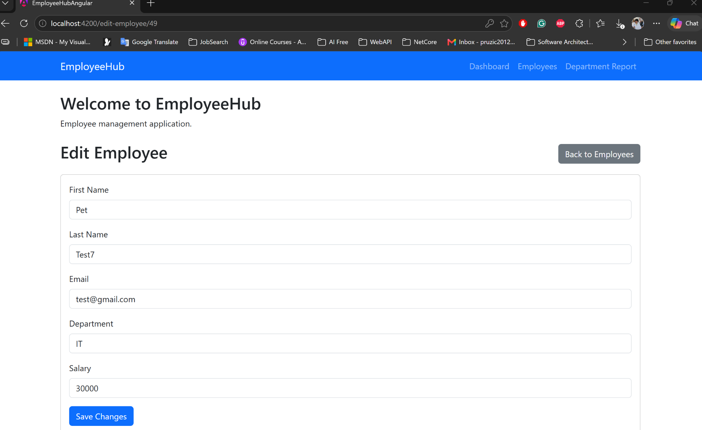

**Delete Employee — Confirmation**

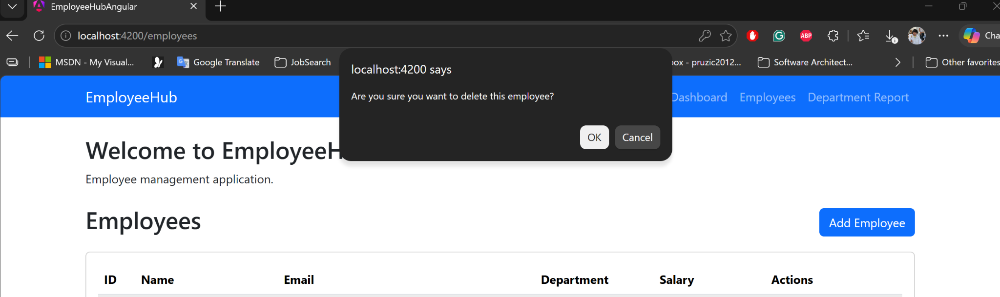

### Blazor Frontend

**Employee Management**

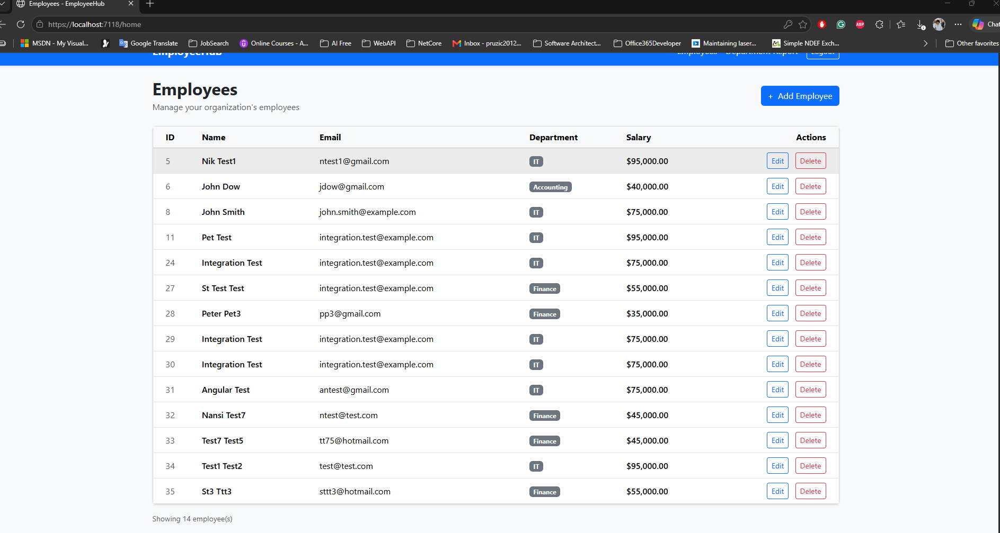

**Login**

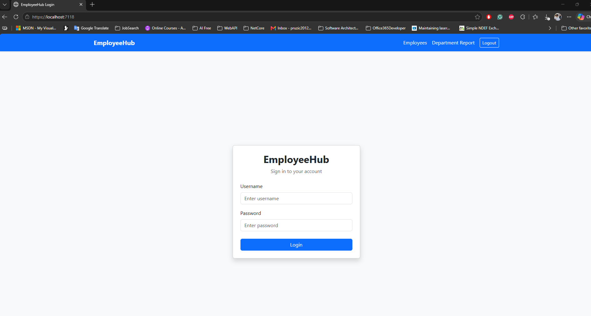

**Add Employee**

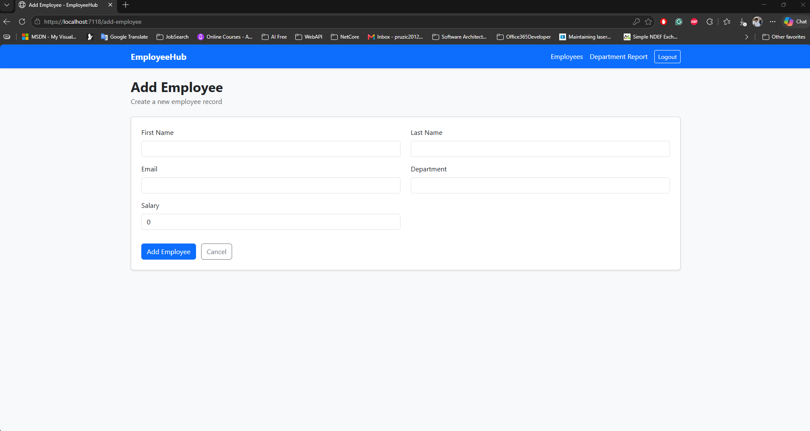

**Edit Employee**

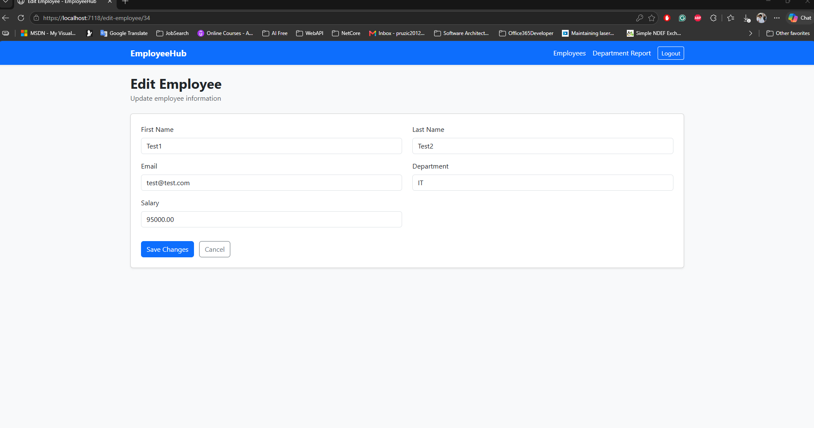

